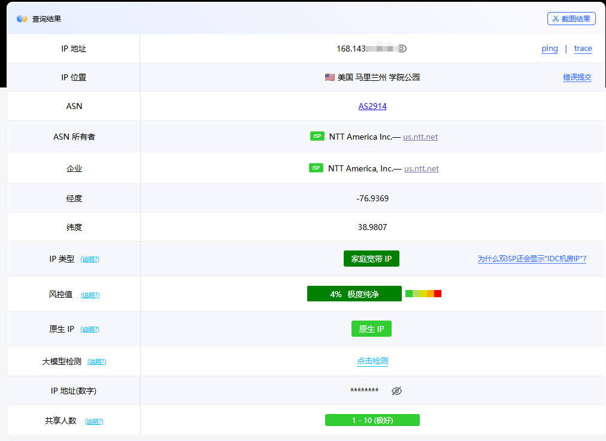

# Claude 账号防封答疑手册：账号六不原则、环境自测与七条防风控技巧

> 作者：Gutask AI 内容团队 · 2026 年 10 月 · [阅读网页版原文](https://www.gutast.com/blog/claude-account-safety-faq.html)

这份手册整理自一线售后 channel 里被问得最多的那些问题：为什么被封？能不能质保？提前续费时间叠不叠加？以及一份可以直接照着做的环境自测清单。无论你是刚拿到 Claude 账号，还是已经用过一阵子，都建议先花 8 分钟通读一遍——它可能帮你省下一个账号的钱。

**三句话读懂本手册**：封号绝大多数是**环境问题**，不是充值问题；上手前先用 ping0.cc 过一遍**五项绿灯**；没有人能保证绝对不封号——六不原则加七条技巧，是把风险概率压到最低，而不是归零。

## 一、账号使用六不原则

Claude 的风控是**综合打分制**：不是触犯某一条就立刻出事，而是每一项异常都在累计扣分。下面六条是最容易踩、也最容易改的坑：

### RULE 01：不频繁切 IP、切号、切设备

环境稳定是第一守则。今天日本、明天新加坡、后天换电脑，风控会认为账号存在共享或盗用嫌疑。

### RULE 02：邮箱接码一天不超过 2 次

频繁请求登录验证码是典型的高危信号，正常用户根本用不到这个频次。

### RULE 03：同一账号设备不超过 3 台

登录设备越多，账号被判定为「多人共用」的概率越高。

### RULE 04：用干净纯净的 IP

优先家庭住宅 IP。机房、云厂商与被滥用的代理 IP 是风控重点观察对象。

### RULE 05：不多人共用一号

共用即高危。使用政策明确禁止让他人使用你的账号，行为轨迹的交叉很难不被识别。

### RULE 06：不用超多人共享的节点

共享人数越多，IP 信誉越差——前面 100 个人做过什么，账都会算到你头上。

## 二、3 分钟环境自测：ping0.cc 五项绿灯

充值之前，先花 3 分钟给网络环境做个体检。浏览器打开测试地址：<https://ping0.cc/>

- **打不开？**说明环境本身异常，先解决代理再谈其他。
- **位置显示在国内？**说明梯子没生效或没开全局，Claude 会直接看到真实出口。

打开之后，对照下表逐项检查，**五项全绿才算达标**：

| 检查项 | 达标标准 | 说明 |
| --- | --- | --- |
| IP 类型 | 家庭宽带 IP | 优先家庭宽带，机房 / IDC 类型慎用 |
| 风控值 | < 20% | 数值越低越纯净 |
| 原生 IP | 是 | 广播地与注册地一致，避免「伪装 IP」 |
| 共享人数 | 0 – 10 最佳 | 共享人数越少，历史污点越可控 |
| IP 位置 | 海外（支持地区） | 显示国内必须先开梯 |

*环境检测合格示例（ping0.cc）：美国马里兰州 · AS2914 NTT America · IP 类型「家庭宽带 IP」· 风控值 4% 极度纯净 · 原生 IP · 共享人数 1-10 极好——以上即为「全绿」的直观长相。*

> 划重点：五项里最值钱的是**「家庭宽带 + 原生 + 低共享」**的组合。风控值偶尔略高不必恐慌，它是动态数据；但 IP 类型是机房、共享人数三位数起步的节点，建议直接换掉。

## 三、高频答疑：封号、售后与续费

### 账号被封禁是什么原因？是充值渠道的问题吗？

先把结论放在这里：**绝大多数封号是环境问题，不是充值问题。**Anthropic 对受支持地区之外的封锁区域用户封控非常严格，封号主要针对「人在被封锁区域使用」这一行为本身。

所以售后边界也很清晰：**充值渠道正规是我们的承诺**——充值若出问题只会「掉订阅」，掉订阅包赔；但**封号属于环境问题，一律无法质保，哪怕刚充值就封号也无法质保**。

正常来说，网络环境干净、操作得当，基本不会出现封号。建议下单前先把网上关于防封的讨论查清楚再决定；新手如果不想折腾环境，**更推荐直接买 GPT Plus，几乎没有风控**。

### 如何降低账号封禁概率？（为什么说「降低」而不是「保证不封」）

因为封禁是**综合打分机制**，触发原因很多，包括但不限于：

1. 网络环境不纯净、环境异常，或使用破限插件触发平台机制；
2. 接入第三方平台、API 插件，或在多个平台 / 设备同时高频切换使用；
3. 用于第三方前端或违规用途；
4. 新注册账号立即充值；
5. 本机或环境此前已被封禁过、留有记录。

使用前先解决网络问题（见第二节自测），再遵守第一节六不原则，就是普通用户能做的全部。单项触发未必出事，但每一项都在累计扣分——这就是为什么只能说「降低」，不能说「绝不」。

### 不幸被封了怎么办？能售后、能退款吗？

很抱歉，封禁原因大概率是上述环境因素，**个人原因造成的封号无法进行售后处理**——请不要误以为是充值渠道的问题。

关于退款，说几个实话：

- 即使是所谓的「黑卡」充值，后果也只是**掉订阅**，跟封禁没有直接联系；
- 网上流传的「官方会退款」：**退款只会退回原创支付渠道**。本店走 Apple ID 渠道充值，退款不会回流到任何一方；自行用信用卡或 Visa 充值的同学可以自己尝试申诉；
- 被封号钱打水漂，换谁都难受。如果觉得自己承受不起这个意外，**坦然的选择是去用几乎无风控的 OpenAI（GPT Plus）**。成年人为自己的选择买单，坦然面对才是最好的解决办法。

如果不幸被封后还想继续使用，请先按第五条的技巧**彻底清理环境**，再换新号，否则会被连带。

### 支持提前续费吗？时间会叠加吗？

支持在现有会员到期前提前续费。但请注意：**新充值的时间会直接覆盖原有剩余时间，并非累计叠加**。比如还剩 20 天时又充了一个月，会员期不会变成 50 天，而是以新充值的周期重新计算。

> 续费提醒：请合理安排充值时机，尽量在剩余天数不多时再续费，避免「越充越亏」。

## 四、Claude 在悄悄记录你的什么

理解防风控技巧之前，先知道对面在看什么。社区实测与公开信息显示，Claude 至少会记录以下八类信号：

| # | 信号 | 具体内容 |
| --- | --- | --- |
| 1 | 当前出口 IP | 你的落地 IP，是否与常驻环境一致 |
| 2 | IP 所属 ASN | 住宅、机房、云厂商、代理商、IDC 一眼可辨 |
| 3 | IP 地理位置 | 国家 / 地区是否在支持名单内 |
| 4 | IP 信誉 | 是否多人共用、是否被滥用、是否频繁换号 |
| 5 | 账号信息 | 邮箱、手机号、支付方式、订阅记录 |
| 6 | 浏览器环境 | Cookie、localStorage、指纹、时区、语言 |
| 7 | 登录历史 | 过去用过哪些 IP、国家、设备 |
| 8 | 行为模式 | 请求频率、并发量、内容是否触发政策风险 |

你会发现：**所有信号都在回答同一个问题——「你是不是一个正常的海外用户」**。第七、八类信号（登录历史、行为模式）只增不减，这也解释了为什么被封过的环境必须彻底清理。

## 五、七条防风控实战技巧

如果曾被封过号，或想把环境做到位，按这七条逐一检查。特别注意第一条：**被封后不清理环境就上新号，会被连带封禁**。

1. **时区**：电脑时区千万不要设成国内，最好设为美国；有条件的使用英文界面和英文对话。时区要与节点地区一致，做到注册时和使用时的时区、节点位置统一。**严禁在未开节点的状态下打开 Claude 客户端**——那等于自报家门。
2. **节点**：使用稳定干净的家庭住宅节点，不要跨区域随意变动。务必开启**全局代理和 TUN 模式**——在未开启的情况下，Claude 现有技术可以检测到你的真实地理位置。
3. **定位**：关闭系统和浏览器对 Claude 网站与客户端的定位权限。
4. **WebRTC 防泄漏**：浏览器安装 WebRTC Leak Shield 扩展并开启严格保护，防止真实 IP 通过 WebRTC 泄漏。
5. **Cookie 清理**：定期清理浏览器中 Claude 相关的残留 Cookie。有条件可以上指纹浏览器，没有条件影响也不大。
6. **设备关联**：如果当前设备封过号，Claude 会有设备记录。把客户端**完全卸载重装**后再使用新号，保留和残留的文件也要清理干净——不会清理可以直接问 AI，让它给你一步步的操作清单。
7. **邮箱**：不要使用国内主流邮箱，建议换成 Gmail 等国外主流邮箱。GitHub 等远程仓库绑定的邮箱也一并更换——编程场景经常要连 GitHub，大陆邮箱会抬高风控权重。

## 写在最后：用就别怕，怕就别用

以上是社区整理的部分防风控技巧。必须坦诚地说：**没有任何人能保证不封号**——风控是综合打分机制，触发某一条未必出事，总分过低才会触发，因此不存在 100% 稳妥的用法。一句话：用就别怕，怕就别用；承受不起意外的话，GPT Plus 几乎没有风控。

如果你想省去环境折腾这一步：[Gutask AI](https://www.gutast.com/) 提供的 Claude Code 直连套餐坚持官方客户端直连非镜像，接入全程**只需要一个 Organization ID，无需交出账号密码**，环境与数据始终留在你自己手里。

## 相关阅读

- [国内接入 ChatGPT / OpenAI API 完整教程](gpt-api-china.md)
- [没有 ChatGPT / OpenAI 账号怎么使用 GPT API](no-openai-account.md)
- [GPT API 中转站选择与避坑指南](api-proxy-guide.md)
- [Claude 封号机制详解：风控逻辑与自保指南（网页版）](https://www.gutast.com/blog/claude-ban-risk-guide)
- [返回项目首页](../README.md)

---

*免责声明：本文整理自社区经验与售后高频问题，仅供参考，不构成任何规避服务条款的建议。请始终遵守 Anthropic 官方使用政策。*
